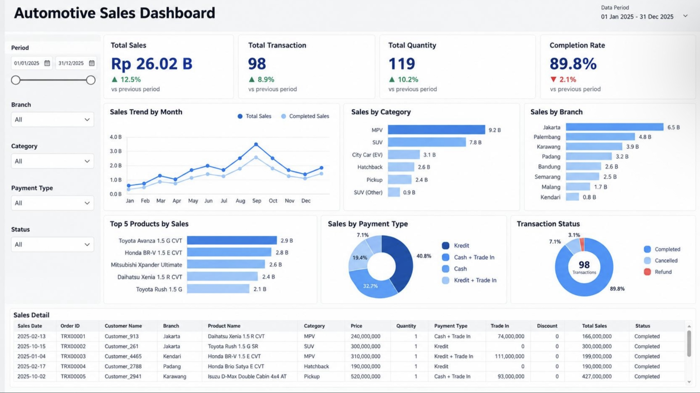

# Automotive Sales Performance Analysis & Dashboard (2025)

## 📌 Executive Summary
This project delivers an end-to-end **Automotive Sales Performance Analytics** solution. By processing over **10,000 corporate transaction records** covering the fiscal year 2025, this project bridges programmatic data engineering (Python Pandas) with corporate business intelligence (Interactive Excel Dashboard). The findings uncover localized branch contributions, consumer segment dynamics, car model yields, and financing distribution to drive strategic decisions in inventory management and sales operations.

## 🚀 Key Business Questions Addressed
1. What is the dealership's high-level sales matrix (Gross revenue, transaction velocity, total quantity, and fulfillment completion)?
2. Which vehicle categories (SUV, MPV, Hatchback, Pickup, or EV) and specific models generate the highest volume and financial value?
3. How are customer payment methods distributed, and what role do Trade-in alternatives play in transaction values?
4. What does the geographic revenue profile look like across different regional branches in Indonesia?

## 📊 Project Architecture & Tech Stack
* **Dataset:** 10,000 rows of raw automobile transaction logs containing: `sales_date`, `order_id`, `customer_name`, `branch`, `product_name`, `category`, `price`, `quantity`, `payment_type`, `trade_in`, `discount`, `total_sales`, and `status`.
* **Data Engineering (Python / Pandas):** Handled ETL pipelines, missing values imputation, strict order deduplication, text normalization, and exploratory data analysis (EDA).
* **Business Intelligence (MS Excel):** Leveraged data modeling, advanced formulas (`XLOOKUP`, `SUMIFS`), Pivot Tables, and interactive cross-filtering elements to create the final Executive Dashboard.

## 🧹 Programmatic Data Cleaning Pipeline (Python)
The raw dataset was refined through a Python Pandas pipeline (`Notebook/Showroom_Mobil.ipynb`) executing the following data auditing steps:
1. **Missing Value Imputation:** Filled blank records in `trade_in` values with `0`.
2. **Deduplication:** Dropped structural row duplicates based on unique `order_id` validation to safeguard data integrity.
3. **Text Standardization:** Normalized string spacing and casing inside `payment_type` (e.g., standardizing *Kredit*, *Cash*, *Cash + Trade In*).
4. **Temporal Calibration:** Converted mixed date values in `sales_date` into standardized `datetime64[ns]` objects for accurate time-series trends.

## 💡 Key Performance Insights
* **Macroscopic Performance:** Total gross revenue reached a massive **Rp 26.02 B** generated across **98 finalized transactions** (moving a total of **119 physical vehicle units**). While gross values grew significantly against historical benchmarks (Sales up +12.5%, Quantity up +10.2%), the overall **Fulfillment Completion Rate fell slightly by 2.1% to 89.8%**, signaling a need for operational review.
* **Temporal Revenue Velocity:** Monthly trendlines reveal low activity in H1 2025, followed by a sharp velocity surge starting in August that spiked into an annual revenue peak in **September (approaching Rp 4.0 B)**, before stabilizing through December.
* **Segment & Model Dominance:** **MPV** leads segment sales generating **Rp 9.2 B**, closely followed by **SUVs** at **Rp 7.8 B**. Individually, the top three revenue-generating models are the *Toyota Avanza 1.5 G CVT* (Rp 2.9 B), *Honda BR-V 1.5 E CVT* (Rp 2.8 B), and *Mitsubishi Xpander Ultimate* (Rp 2.6 B).
* **Regional Contribution:** **Jakarta** represents the primary operational growth engine commanding **Rp 6.5 B** in total sales, followed by Palembang (Rp 4.8 B) and Karawang (Rp 3.9 B), while the Kendari branch trails at the bottom with Rp 0.8 B.
* **Financing Channels:** Structured **Credit (Kredit)** remains the highly preferred buying mechanism accounting for **40.8%** of total transaction velocity, followed by direct **Cash (32.7%)**, while options integrated with Trade-Ins fill the remaining split.

## 🎯 Strategic Business Recommendations
Based on the dashboard insights and data analysis, the following data-driven strategies are recommended for executive stakeholders:

1. **Optimize Order Fulfillment Processes:** 
   * **Insight:** Even though total sales value increased by 12.5%, the overall transaction Completion Rate dropped by 2.1% to 89.8%. 
   * **Action:** Investigate operational bottlenecks causing cancellations or refunds (e.g., in branches like Karawang which shows high refund counts). Streamline the supply chain to minimize fulfillment delays.

2. **Capitalize on Peak Seasonal Demand:**
   * **Insight:** Transaction velocity and revenue show an aggressive surge in Q3, peaking heavily in September (approaching Rp 4.0 B).
   * **Action:** Allocate maximum marketing budget and run aggressive promotional campaigns leading up to August and September. Ensure popular inventory (MPVs and SUVs) is heavily stocked before this high-velocity period to avoid lost sales.

3. **Tailor Inventory and Marketing to Segment Preferences:**
   * **Insight:** MPV (Rp 9.2 B) and SUV (Rp 7.8 B) segments dominate corporate revenue, with Toyota Avanza and Honda BR-V as top-selling models. Conversely, City Cars (EV) generate lower revenue share.
   * **Action:** Maintain high inventory turnover for high-yield MPVs and SUVs. For the EV/City Car segment, re-evaluate the target market or launch educational marketing campaigns focused on eco-friendly efficiency to boost its lower transaction counts.

4. **Replicate Jakarta's Success & Intervene in Low-Performing Regions:**
   * **Insight:** Jakarta is the primary revenue powerhouse (Rp 6.5 B), while secondary regions like Palembang and Karawang perform well, but Kendari trails significantly at the bottom (Rp 0.8 B).
   * **Action:** Document and duplicate Jakarta’s dealership operations, sales training, and local marketing strategies to secondary branches. Conduct a localized market assessment in Kendari to identify if the low revenue is caused by poor brand awareness, pricing misalignment, or mismatch in inventory selection.

5. **Enhance Credit Financing Incentives:**
   * **Insight:** Traditional Credit (Kredit) is the most preferred channel commanding 40.8% of total transaction velocity, followed by Cash at 32.7%.
   * **Action:** Strengthen partnerships with multi-finance companies or banking institutions to offer more competitive credit interest rates or lower down-payment (DP) programs, as this is the primary purchasing driver for customers.

## 📈 Executive Dashboard Interface
Below is the interactive control interface designed for stakeholders:

---
📫 **Connect with Me:**
* **LinkedIn:** www.linkedin.com/in/nabila-r-180597244/
* **Email:** bella.rahmahusna@gmail.com
